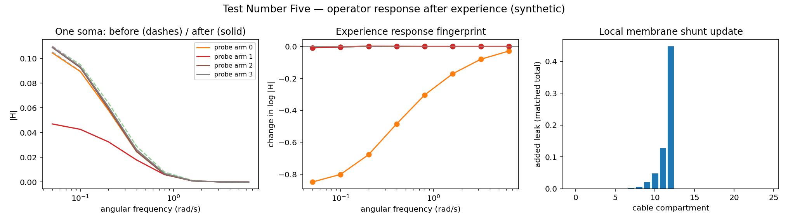

# Test Number Five — Experience-Response Spectroscopy

**Can the next electrical signal reveal what happened to a system, even when the signal itself has disappeared?**

[**Open the interactive cable microscope**](https://anttiluode.github.io/TestNumberFive/web/) · [Preregistered tests](PREREG.md) · [Recorded results](results/gates.json) · [InformationalSpectra](https://github.com/anttiluode/InformationalSpectra)

The trajectory is `Sigh` → `Sihti` → self-EQ → dendritic cable → operator changed by experience → spectroscopy of the *consequences* of that experience. Instead of trying to decode an earlier pulse from a current voltage, this experiment observes how a cable's **response to an identical later probe** has changed. This is a toy, not a reconstruction of a real neuron.



## A physical toy you can interrogate

A single soma connects four dendritic branches, six compartments per branch (25 compartments total). Each compartment has a capacitance and leak; neighboring compartments exchange current through axial conductances. This is a linear *passive* cable, although the slow write step changes its operator.

```text
                               [tip 1]
                                  |
                                  | (six compartments)
                                  |
  [tip 4] -----------           SOMA           ----------- [tip 2]
                                  |
                                  | (six compartments)
                                  |
                               [tip 3]

  experience: inject one unit impulse at one tip
              integrate local squared voltage during relaxation
              add a total of 0.65 shunt conductance distributed by that activity
              reset voltage to zero

  measurement: inject identical sinusoidal test probes from EACH of four tips
               observe frequency-dependent complex response ONLY at the soma
```

The experiment does **not** inject the history label into a memory slot. The *location of the impulse* determines the experienced voltage distribution, and local eligibility determines the slow conductance change. Every experience uses the same total shunt budget.

### Two different signals, separated in time

Fast membrane voltage:

\[C\dot v=-Gv+b u(t).\]

A transient input at one branch deposits local eligibility \(e_i=\int v_i^2dt\), and changes the cable through

\[G'=G+\operatorname{diag}\left(0.65\,e_i/\sum_j e_j\right).\]

After the original voltage disappears, the same new probe is presented to unchanged input ports and one recording site:

\[H_{s\leftarrow b}(\omega)=e_s^T(G+i\omega C)^{-1}b.\]

The observable **experience fingerprint** is \(\Delta\log|H|=\log|H_{after}|-\log|H_{before}|\). The word *spectrum* has three distinct meanings here: the cable operator's dynamical eigenmodes, the probe-to-soma temporal-frequency transfer response, and the frequency-resolved difference after experience. They are connected, but not synonymous.

## Registered gates: first run

The [thresholds were committed before code/gate execution](PREREG.md). All four possible experiences were tested on each of 80 independently jittered cable geometries; seed 0–39 trained a fixed linear decoder and 40–79 were strictly held out. The frozen decoder has no knowledge of the exact held-out geometry.

| Gate | Criterion | Measured | Verdict |
|---|---|---|---|
| G1 persistent trace | ≥90% of experiences leave ≥0.01 RMS change after voltage reset; sham zero | 100% above threshold, median RMS 0.264, sham exactly zero | **PASS** |
| G2 paired response gives unique benefit | four-way held-out decoding ≥75% **and** ≥10 percentage points better than unpaired after-only | Paired **100%**, unpaired after-only **100%** | **FAIL** |
| G3 native spectral prediction | 8-mode graph basis median relative error ≤70% of equal-sized coordinate-cosine basis | Graph median error **0.748**, cosine **2.176**; ratio **0.344** | **PASS** |
| G4 label-independent sham | held-out decoding ≤40% | **17.5%** (chance expectation 25%) | **PASS** |
| G5 probe locations matter | multiple probe ports ≥10 percentage points better than fixed single port | Four ports **100%**, single port **51.25%** | **PASS** |

**Most important failure:** this toy is too easy in one respect. The after-only response already perfectly reveals which branch was changed. Paired subtraction adds no decoding benefit, so **G2 fails**. That rules out claiming this experiment established that a before/after subtraction is uniquely necessary. A future nuisance-variation experiment should stress this gap, explicitly as a separately registered follow-up.

**Interpret G3 narrowly:** the low modes of the *true physical operator* outperform eight modes based on an arbitrary order of compartment indices on this tree, as expected in this setting. This demonstrates a useful prediction advantage for the holding operator; it does **not** establish a new universal spectral law. The absolute errors are not small, especially where distal transfer magnitudes become tiny.

**Interpret G1 narrowly:** the slow plasticity is built into the toy as a rule. G1 verifies that it actually creates a persistent, readable dynamical consequence after the original transient is removed; it does not prove that a real dendrite learns via this particular shunt rule.

### Bonus: making the spectral shift visible

`python -m src.mode_shifts` computes the first-order sensitivity of the generalized cable eigenvalues when the *membrane shunt* changes:

\[\delta\lambda_k\simeq\sum_i\delta g_i\,\phi_k(i)^2.\]

For an **axial edge** rather than a membrane shunt, it would be \(\delta\lambda_k\simeq\delta w_{ab}(\phi_k(a)-\phi_k(b))^2\), the earlier graph-sensitivity equation. The first-order calculation uses 10% of the full shunt write, and is **exploratory, not a preregistered sixth gate**. See [mode shifts](results/mode_shifts.json).

## Make the browser microscope live

The browser is committed at `web/index.html`, but GitHub Pages is not automatically enabled for a brand-new repository. A deploy workflow is included. Once, as the repository owner, visit **Settings → Pages → Build and deployment → Source: GitHub Actions**. Then rerun the failed **Publish cable microscope** workflow, or push a new commit. Until Pages is enabled, the live-page link above may return 404. You can always run it locally as shown below.

## Run it

```sh
python -m pip install -r requirements.txt
python -m unittest discover -s tests -v
python -m src.experiment              # fixed 5-gate protocol; JSON, NPZ, PNG in results/
python -m src.mode_shifts             # exploratory mode sensitivity
python -m src.export_web              # regenerate Python reference for the web microscope
node tests/browser_parity.mjs         # checks JS and NumPy agree, complex values and write update
python -m http.server 8000            # visit http://localhost:8000/web/
```

Uses NumPy and Matplotlib; the browser microscope uses no frameworks, pretrained models, internet APIs, or network accounts. It performs the same 25×25 complex cable calculations directly in JavaScript; the parity test compares its transfer matrices **before and after every possible experience** with the NumPy reference.

On systems with threaded BLAS, run `OPENBLAS_NUM_THREADS=1 python -m src.experiment` for predictable speed. The code is modest enough for CPU; no GPU needed.

## What this deliberately does **not** claim

- A passive graph and a toy plasticity rule do not recreate calcium, dendritic spikes, gene expression, structural remodeling, or biological memory.
- Information surviving in the full microscopic state is not the same as information recoverable at the soma. Here we control the entire graph and choose probe ports; we cannot infer the brain's full state from a biological electrode.
- Operator eigenmodes do not automatically correspond to meaning or semantic frequency. Low mode ≠ meaning and high mode ≠ detail.
- A frozen transformer can have a *context-dependent effective attention operator*, but does not acquire permanent conductance-like changes during ordinary inference. This experiment does not test an LLM; a corresponding transformer experiment would need separate definitions of operator, probes, and causal intervention.
- The unpaired control's success is a genuine limitation of the present setup, not something to optimize away after observing the results.

### Relationship to previous projects

- **Sigh / Sihti:** the image becomes the filtering operator, not just the signal passed through it.
- **SolsBaby:** a local process can modify a slow conductance visible later from the soma.
- **GrowingMatrix / GraphNN:** writes modify couplings and selectively change possible readouts.
- **Naula / InformationalSpectra:** distinguish what exists internally, what a reader can observe, and what an intervention can modify. This repo targets **changes in a response transfer function** as a concrete observable.

License: see [LICENSE](LICENSE).
